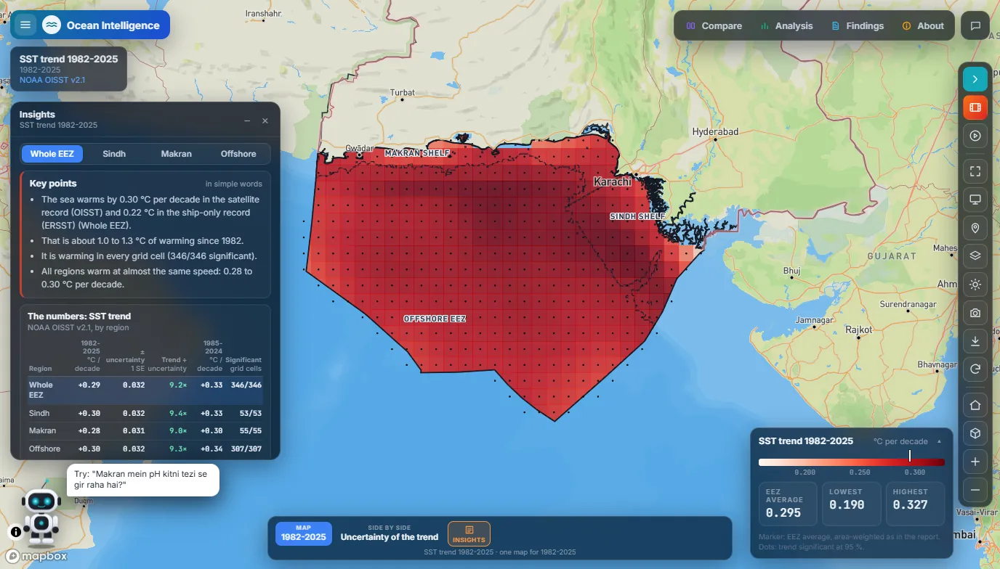
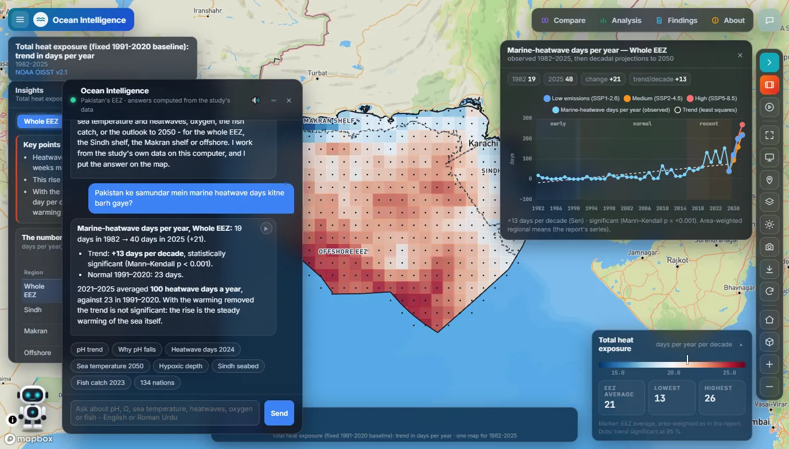
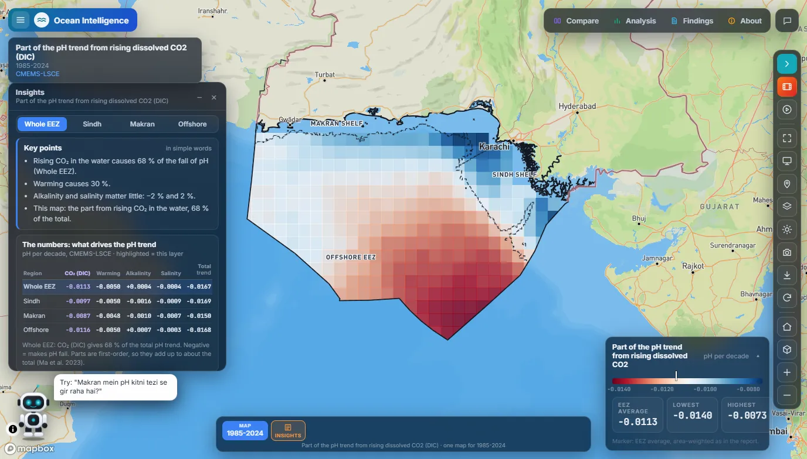
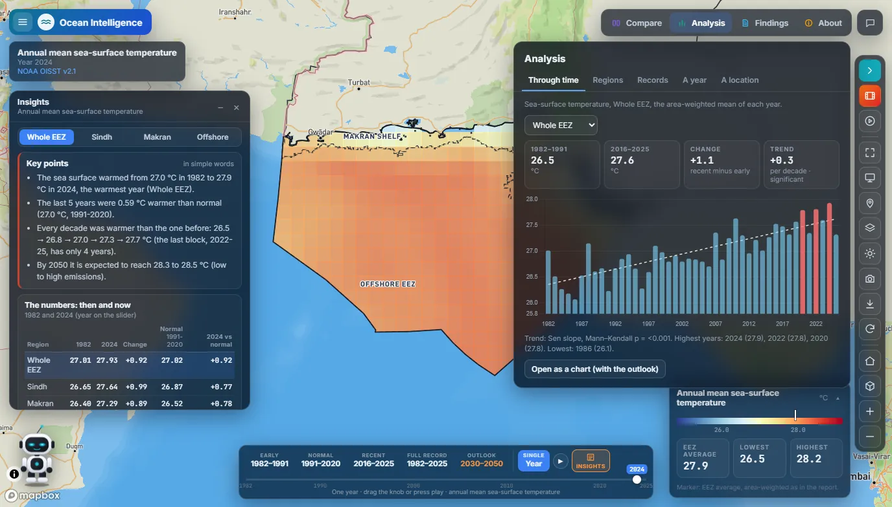
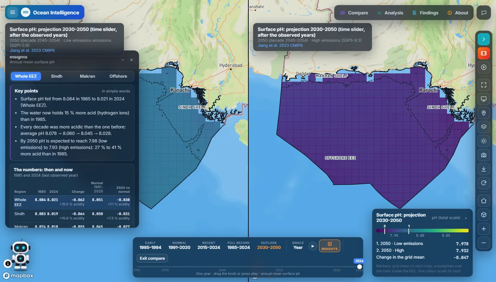
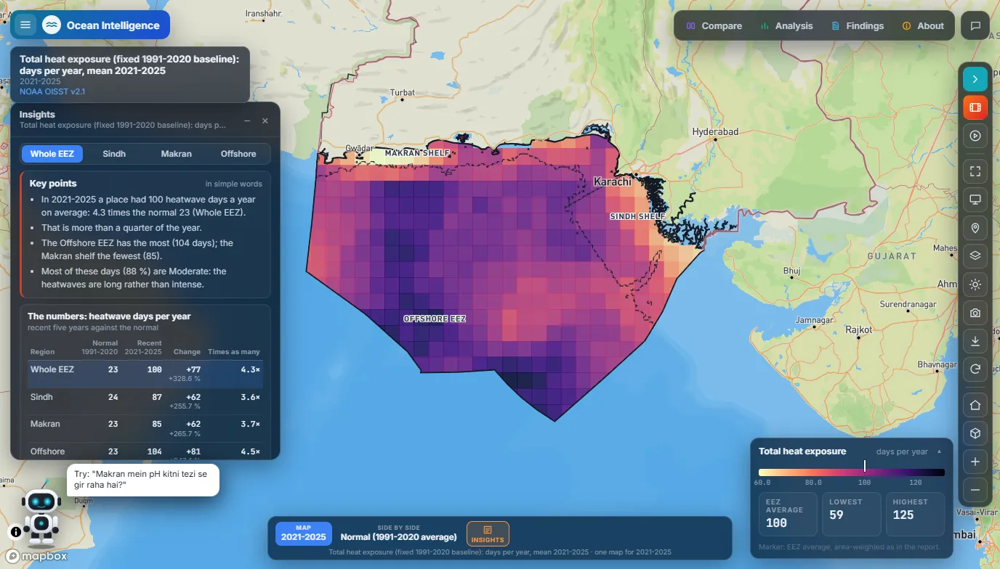
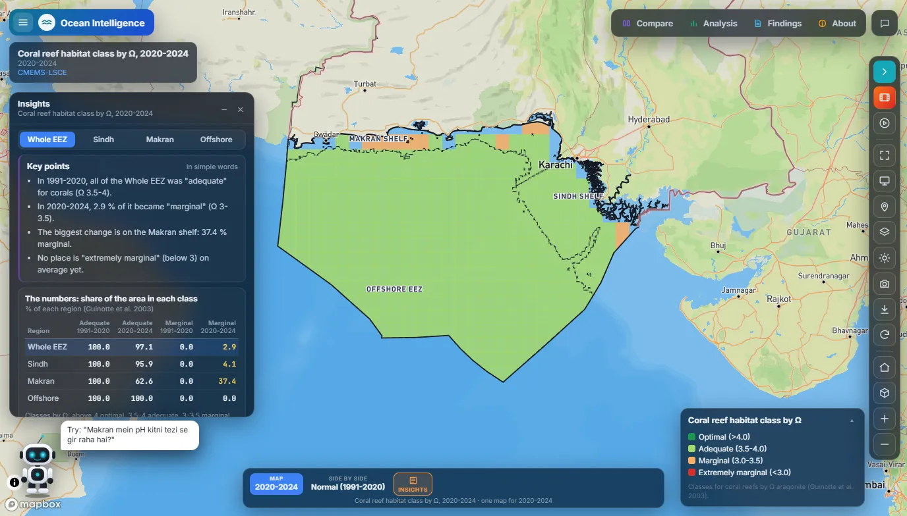
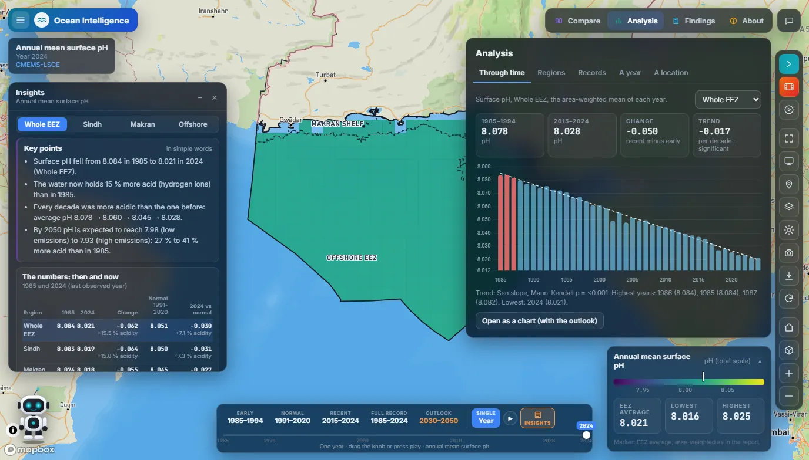
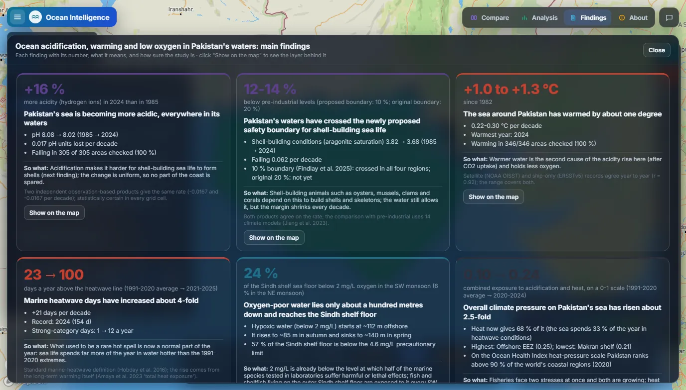
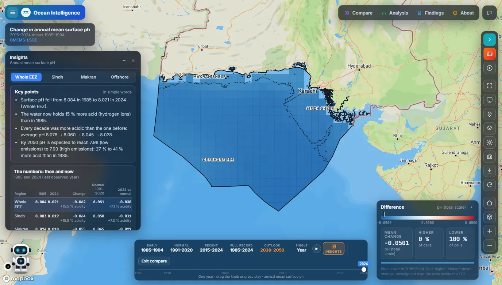

# Ocean Intelligence

A web portal for NDMA Pakistan that shows how acidity, heat and oxygen in Pakistan's seas have changed since the 1980s, and where they are heading by 2050.

**Demo video:** [watch on LinkedIn](https://lnkd.in/p/dcSiaMx6)

## What it does

- **Acidification, mapped**: surface pH across Pakistan's Exclusive Economic Zone fell from 8.08 in 1985 to 8.02 in 2024, about 16% more acidity, and it fell in every area checked.
- **Warming and marine heatwaves**: the sea has warmed by 1.0 to 1.3 °C since 1982, and days above the marine-heatwave line rose from about 23 a year (1991-2020 average) to about 100 (2021-2025).
- **Low oxygen on the shelf**: in the southwest monsoon, 24% of the Sindh shelf floor sits below 2 mg/L of oxygen.
- **Outlook to 2050**: low- and high-emission paths, side by side or against today.
- **Compare, trends and findings**: swipe, side-by-side or difference views, Mann-Kendall trends for any region or place, and a findings page that explains each result in plain words.
- **A chat assistant**: questions in English or Roman Urdu, answered from the study's numbers.

| | |
|---|---|
|  |  |
| A question in Roman Urdu, answered with the study's numbers, a chart and the map. | What drives the fall in pH: rising CO₂ gives 68%, warming 30%. |
|  |  |
| Sea-surface temperature through time, 1982-2025, with its trend. | Surface pH in 2050, low emissions against high emissions. |
|  |  |
| Marine heatwave days a year, 2021-2025, against the 1991-2020 normal. | Coral habitat class by aragonite saturation, 2020-2024: 37% of the Makran shelf is now marginal. |
|  |  |
| Surface pH through time, 1985-2024, with its trend. | The main findings, each with what it means. |
|  |  |
| Change in surface pH, 2015-2024 minus 1985-1994: lower everywhere. |  |

## Built with

Mapbox GL JS, JavaScript, Chart.js, Python

## Data

Copernicus Marine (CMEMS-LSCE), NOAA OISST, ERSSTv5, FAO FishStat

## Code and data access

The source code is private and belongs to NDMA Pakistan. To ask about the code or the data,
email **ranahasnain061@gmail.com**, [open an issue](../../issues) in this repository, or message me on
[LinkedIn](https://www.linkedin.com/in/muhammad-hasnain-87450033a/).

---
Built by [Muhammad Hasnain](https://hasnain061-ai.github.io) at NDMA Pakistan.
